  

  
  
  

**14 topics, 88 docs, 166 diagrams, all in simple English. [Open devops-docs](https://github.com/Akhilgoud01/devops-docs)**

| | Topic | What's inside |
|---|---|---|
| 🧭 | [devops-fundamentals](https://github.com/Akhilgoud01/devops-docs/tree/main/devops-fundamentals) | Culture, lifecycle, Agile, deployment strategies, DORA, SRE |
| 🐧 | [linux-for-devops](https://github.com/Akhilgoud01/devops-docs/tree/main/linux-for-devops) | Filesystem, permissions, systemd, cron, grep/sed/awk, SSH |
| 🌿 | [git-and-github](https://github.com/Akhilgoud01/devops-docs/tree/main/git-and-github) | Branching, PRs, GitFlow, trunk-based, GitHub features |
| 🌐 | [networking-for-devops](https://github.com/Akhilgoud01/devops-docs/tree/main/networking-for-devops) | OSI, TCP/IP, subnets, DNS, TLS, load balancers |
| 🐍 | [scripting-bash-python](https://github.com/Akhilgoud01/devops-docs/tree/main/scripting-bash-python) | Bash, Python, boto3, YAML/JSON |
| 🔁 | [cicd-pipelines](https://github.com/Akhilgoud01/devops-docs/tree/main/cicd-pipelines) | GitHub Actions, Jenkins, GitLab CI, quality gates |
| 🐳 | [docker-containers](https://github.com/Akhilgoud01/devops-docs/tree/main/docker-containers) | Images, Dockerfile, multi-stage, Compose, security |
| ☸️ | [kubernetes-guide](https://github.com/Akhilgoud01/devops-docs/tree/main/kubernetes-guide) | Architecture, Pods, Services, storage, HPA, RBAC |
| ⛵ | [helm-and-gitops](https://github.com/Akhilgoud01/devops-docs/tree/main/helm-and-gitops) | Helm, GitOps, Argo CD, Kustomize |
| 🏗️ | [infrastructure-as-code](https://github.com/Akhilgoud01/devops-docs/tree/main/infrastructure-as-code) | Terraform, Ansible, CloudFormation, Pulumi |
| ☁️ | [cloud-fundamentals](https://github.com/Akhilgoud01/devops-docs/tree/main/cloud-fundamentals) | AWS core, VPC, IAM, Azure/GCP, cost |
| 📊 | [monitoring-observability](https://github.com/Akhilgoud01/devops-docs/tree/main/monitoring-observability) | Prometheus, Grafana, ELK/Loki, tracing, incidents |
| 🛡️ | [devsecops-security](https://github.com/Akhilgoud01/devops-docs/tree/main/devsecops-security) | Shift-left, secrets, container security, supply chain |
| 🗺️ | [devops-roadmap-and-interviews](https://github.com/Akhilgoud01/devops-docs/tree/main/devops-roadmap-and-interviews) | Roadmap, projects, interview Q&A, certifications |

  
  
  

